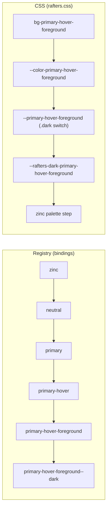

# How the Rafters Token Cascade Works

Measured at rafters `72ac0c6f` (2026-10-19). Keep it current: see the
[package README](../README.md#keeping-the-docs-current).

Not yet re-measured since then. Three changes reached the CSS after that
commit, and the counts below predate them:

- The role layer (#2745, 0.4.5): every semantic declaration now points at its
  owning role's step (`--rafters-primary-hover: var(--rafters-primary-950)`),
  and each role step points at its palette, so a role change moves every token
  that role owns in the browser.
- The theme mapping (#2825): spacing, radius, shadow, typography, depth,
  breakpoint and focus tokens are each set on `:root` as `--rafters-<token>`,
  and their Tailwind theme keys read `var(--rafters-<token>)`. Breakpoints
  stay literal in the theme because media queries cannot read `var()`.
- Fills (#2827 to #2830): a `fill` namespace whose tokens are recipes, not CSS
  values. Each is written as a `bg-fill-<name>` (or, for the 37 generated
  surfaces, `bg-surface-<name>`) utility built from stock Tailwind classes. A
  fill's colours are references to registry tokens, so it follows them.

## The short version

A rafters cascade is one rule applied again and again: a token derives from a
parent, and when the parent changes, the token follows. The rule is recursive
because every child can be a parent, so one change at the bottom, a palette or
the spacing base, can travel five hops.

The rule runs on three layers. A token can be linked on one layer and broken on
another.

| Layer | What it is | Who reads it | What follows a change |
| --- | --- | --- | --- |
| `dependsOn` | parent names written on the token | the token graph, `rafters_describe`, veneer's docs | nothing: it is a record |
| binding | a plugin and its input that recompute the value | the `TokenRegistry`: Studio, `registry.set`, every load | registry values, then the next export |
| CSS `var()` and `calc()` | `rafters.css` declarations that reference other custom properties | the browser, at render time | the live page, at once |

Rafters tokens are CSS only, so the CSS layer is the design. The other two
layers should describe the same edges.

Every namespace has a base and tokens derived from it, but each uses a different
subset of the layers. Only semantic colour has bindings (414 tokens). Spacing,
radius and focus cascade in CSS only. Typography's scale, shadow geometry,
breakpoints and most motion write `dependsOn` with nothing behind it.

## The colour cascade

In the registry, colour is a real tree: a change at `zinc` travels through
`neutral` to `primary`, then to its states, its foregrounds and its dark twins,
up to five hops. In the CSS, the same tokens are a flat list: each one points
straight at a palette step.

The deepest chain in the default system is `primary-hover-foreground--dark`,
five hops from `zinc`. Semantic chain depths:

| Hops to a palette | Tokens |
| --- | --- |
| 1 | 11 |
| 2 | 85 |
| 3 | 171 |
| 4 | 122 |
| 5 | 25 |

In CSS every one of them is the same four hops: utility, theme switch, role
value, palette step.

## The building blocks

Every edge in the cascade is one of a few node types. The registry has four in
use and two defined but unused by the defaults; the CSS has four constructs.

| Node type | Layer | Reads | Produces | Tokens (default system) |
| --- | --- | --- | --- | --- |
| `scale` | binding | a family (a palette or a role name) and a step index | that family's colour at that step | 58 |
| `mirror` | binding | a light token and an offset | its dark twin, the mirrored step shifted by the offset | 58 |
| `contrast` | binding | a parent token and a level (AA or AAA) | a foreground step that passes against the parent, picked by color-utils `semanticFor` | 132 |
| `state` | binding | a parent token and a state: hover, active, focus, disabled, border, ring or subtle | a step on the parent family's AAA ladder | 166 |
| `invert` | binding | a pair | the pair inverted for dark | 0 (defined, unused) |
| `calc` | binding | an arithmetic expression over token values | a computed value | 0 (defined, unused) |
| pass-through | CSS | `var(--other)` | the other property's value | most derived tokens outside colour |
| scaled | CSS | `calc(var(--base) * n)` | a multiple of a base | spacing, radius, focus |
| theme switch | CSS | `:root` sets `--primary: var(--rafters-primary)`, `.dark` sets `--primary: var(--rafters-dark-primary)` | the right mode's value | all 207 colour roles |
| utility bridge | CSS | `@theme inline` sets `--color-primary: var(--primary)` | the Tailwind utility (`bg-primary`) | every colour role |

A binding names its parent in its input (`familyName`, `against`, `from`,
`fromToken`); that is the edge the registry follows. `dependsOn` is written
separately and can disagree with it.

## Same for everything, but not

| Namespace | Tokens | Base | `dependsOn` | Registry binding | CSS chain | Follows its base in the browser |
| --- | --- | --- | --- | --- | --- | --- |
| semantic colour | 414 | a palette, through a role root | all 414 | all 414, up to 5 hops deep | flat: utility, theme switch, `--rafters-<role>`, a palette step | only the light/dark switch; a role change moves nothing |
| palette colour | 84 | none | none | none | literal `oklch()` | leaf |
| spacing | 24 | `spacing-base` | 22 | none | `calc(var(--rafters-spacing-base) * n)` | yes |
| radius | 38 | `radius-base`, itself `spacing-base` x 1.5 | 36 | none | `calc(var(--rafters-radius-base) * n)` | yes |
| focus | 16 | `spacing-base` and `ring` | 16 | none | `calc(var(--rafters-spacing-base) / 2)`, `var(--ring)` | yes |
| typography | 56 | `font-size-base`, `font-sans` | 42, one pointing at itself | none | font sizes literal rem; `--font-heading: var(--font-sans)` | families yes, the size scale no |
| typography composites | 14 | typography tokens | 14, one naming a token that does not exist | none | not emitted as custom properties | not traced |
| shadow | 47 | `shadow-base-unit` from `spacing-base` | 45 | none | composites `var()` their parts; parts and base unit literal | composites follow their parts; geometry does not follow spacing |
| motion | 143 | duration tiers and easings | 86 | none | tiers literal; 17 animations `var()` the tiers; 64 cell tokens emit no custom property | partly |
| breakpoint | 33 | `breakpoint-*` | 10 | none | literal px; `@media` cannot read `var()` | no, a CSS limit |
| depth | 12 | none | none | none | literal | leaf |

The three layers agree for spacing, radius and focus. Semantic colour is the
opposite case: complete in the registry, flat in CSS.

## Where it breaks today

The registry engine works: with every role root set to a new family, the only
semantic tokens that do not follow are `chart-1` to `chart-5` in light and dark
(10 tokens), which are unlinked by design. Rafters' own test
asserts it: `leaves only the charts unchanged when every role moves` in
`packages/design-tokens/test/cascade.test.ts`. What still breaks is the wiring,
and on which layer.

| Break | Layer | Measured | Issue |
| --- | --- | --- | --- |
| Light and dark point at each other in `dependsOn`: every light token lists its dark twin, while dark tokens derive from light | `dependsOn` | 207 light, 58 dark | not filed |
| Loading the registry replaces designed steps with computed ones | binding | 199 steps (measured at c3c0a24b) | [#2662](https://github.com/rafters-studio/rafters/issues/2662) |
| The font-size scale is literal rem; `font-size-base` is emitted twice and depends on itself | CSS, `dependsOn` | 13 sizes | [#2647](https://github.com/rafters-studio/rafters/issues/2647) |
| Line height and letter spacing claim a font-size dependency they do not have | `dependsOn` | 26 | [#2664](https://github.com/rafters-studio/rafters/issues/2664) |
| Shadow geometry has no path from `spacing-base` | all three | 36 parts | [#2648](https://github.com/rafters-studio/rafters/issues/2648) |
| `dependsOn` never says which layer carries it | `dependsOn` | 271 tokens with no binding | [#2665](https://github.com/rafters-studio/rafters/issues/2665) |
| Motion holds two unlinked copies of its durations and curves (`motion-duration-*` and `motion-easing-*` beside the `rafters-duration-*` and `rafters-ease-*` leaves the CSS uses), and 5 composite presets emit frozen literals | binding, CSS | 2 sets, 5 presets | [#2746](https://github.com/rafters-studio/rafters/issues/2746) |
| A typography composite names a token that does not exist (`shortcut` to `letter-spacing-widest`) | `dependsOn` | 1 | not filed |

Fixed since the first measurement (c3c0a24b): 60 semantic steps bound to a
palette instead of their role, and `ring-primary`, `sidebar-primary`,
`sidebar-accent` and `sidebar-muted` hanging off `neutral`
([#2743](https://github.com/rafters-studio/rafters/issues/2743)).

Fixed since 72ac0c6f: the CSS had no role layer, so 404 of 414 semantic
tokens pointed at a palette step instead of their role
([#2745](https://github.com/rafters-studio/rafters/issues/2745)).

## How to check a cascade

Each layer is checked a different way, against rafters' own code, never a copy
of its logic.

1. **Registry.** Build a `TokenRegistry` over `generateBaseSystem().allTokens`
   with the CLI's plugins (scale, contrast, state, invert, mirror). Define a new
   family per role, `registry.set` each role root to it, and diff every semantic
   token against an untouched registry.
2. **Classify what stayed.** For each unchanged token, follow its binding inputs
   (`familyName`, `against`, `from`, `fromToken`) upward. Reaching a set root
   while unchanged is an engine failure (today: 0). Reaching only a palette is
   unlinked wiring (today: the 10 chart tokens).
3. **CSS.** Emit the CSS with `registryToTailwind`, then follow each custom
   property's `var()` references to a literal. A token is linked in CSS only if
   its chain passes through its parent's property.
4. **`dependsOn`.** Compare each token's `dependsOn` with its binding input and
   its CSS chain. Any of the three disagreeing is a defect.

Rafters' own tests cover step 1 for the default roles
(`packages/design-tokens/test/cascade.test.ts`). The Rafters Color Explorer, a
private page shared on request, runs steps 1 to 3 live in the browser on
rafters' own code and checks any `rafters.css` loaded into it.
